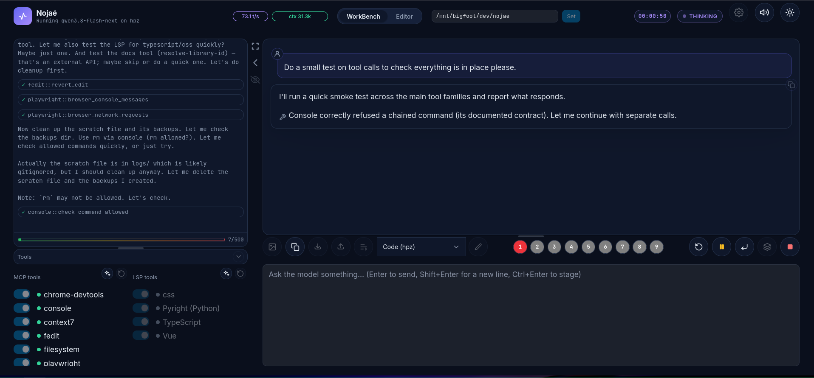
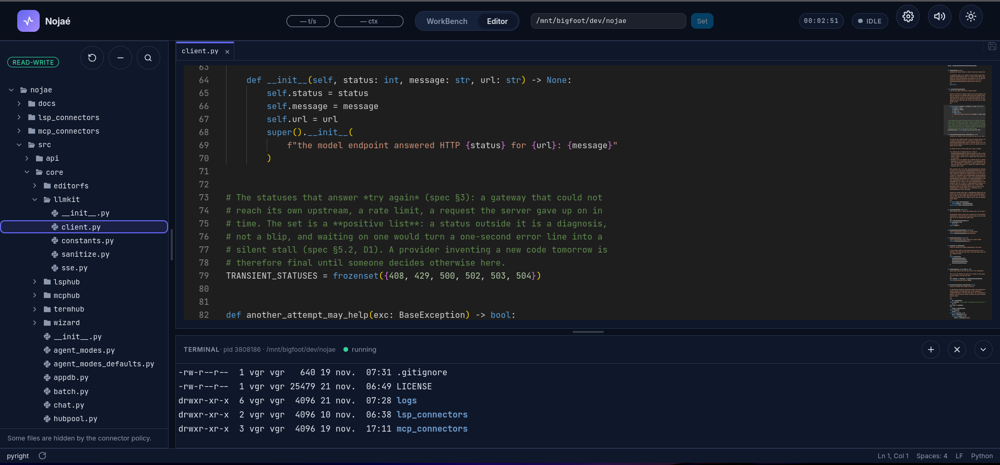

# Nojaé

**A workspace where a coding agent works in front of you: a model writes your
code, you decide what to keep.**

Self-hosted — FastAPI behind, Vue 3 in front, one browser tab in between — and
it puts that agent to work on a real checkout, in two pages.

**The WorkBench** drives the conversation: a model of your choice, the file
tools, the language servers and the shell commands it is allowed to use, and a
workspace whose read/write policy you set.

**The Editor** shows the same tree the agent changes, with a Monaco pane and a
real terminal — so you watch each edit land, and commit it when you agree.

Everything streams: answers, reasoning, tool calls and timings arrive over
Server-Sent Events, and nothing about your code or your endpoint leaves the
machine.



*The **WorkBench**. Left: every tool call the agent made and the connector that
answered; below that, the MCP and language servers it may reach. Right: the
conversation, streaming.*



*The **Editor**, same folder: the tree the agent is changing, a Monaco pane
served by the project's language servers, and a real terminal below it.*

---

## Getting started

You need **Python ≥ 3.10** and **Node.js**. Desktop browsers only.

### Install

<details open>
<summary><b>Linux</b></summary>

```bash
cd /path/to/nojae
python -m venv .venv && source .venv/bin/activate
pip install -e ".[mcp,lsp]"

cd web && npm install && npm run build && cd ..
```

</details>

<details>
<summary><b>Windows</b></summary>

**Git for Windows is required** — it is what gives the terminal and the shell
connector their command vocabulary. See [Setup](docs/SETUP.md).

```powershell
py -3.12 -m venv .venv
.venv\Scripts\Activate.ps1
pip install -e ".[mcp,lsp,windows]"

cd web
npm install
npm run build
cd ..
```

</details>

The extras are optional and none is mandatory:

| Extra | What it adds |
|---|---|
| `mcp` | The MCP SDK and Playwright — the WorkBench connectors. |
| `lsp` | The LSP client — the language-server tools. |
| `windows` | The Editor terminal's pseudo-console driver. Never pulled in on Linux. |
| `test` | `pytest` and its plugins. |

### Run

```bash
nojae
```

Open <http://127.0.0.1:8001>.

### Then: one setting

A fresh install has **no model**, and no turn can run until you give it one.
Open **Settings → Servers**, add your OpenAI-compatible endpoint
(`http://127.0.0.1:8080/v1` for a local llama.cpp), press **Fetch models**, and
add a model under it. Then give an agent that model. Nothing else is required
for the Editor; the connectors only decide how far the agent may reach.

### Test

```bash
pytest                          # backend
cd web
npm test                        # frontend
npx playwright install --with-deps chromium  # once: the browser e2e drives
npm run test:e2e                # end-to-end
```

Both suites are hermetic: no reachable model is needed — the end-to-end one is
answered by a stub model server the harness starts itself — both hubs are
switched off, and every test runs on a temporary settings store of its own.
Detail: [Setting up tests for nojae](docs/SETUP.md#setting-up-tests-for-nojae).

---

## What you get

**WorkBench** — a streaming chat with the agent you pick: **Chat** (no tools),
**Code** (file tools and language servers), **Architect** (reads and writes a
spec, never your code), **Todo builder**. Plus **batch mode**, which works
through a folder of task files unattended, and a composer that stages several
messages into one turn.

**Editor** — the tab's folder as a tree, a Monaco pane with real diagnostics,
and one terminal per connection. Nothing is destroyed: every save keeps the
bytes it replaced, and a delete goes to a dated trash.

**Local by construction** — your code and your endpoint stay on your machine.
The agent's reach is bounded by a per-workspace read/write policy, and the
connectors answer through it, so a folder you mark read-only is not editable by
an agent either.

Full detail: **[What the app does](docs/FEATURES.md)**.

---

## Documentation

| | |
|---|---|
| **[Setup](docs/SETUP.md)** | Both platforms in full, Volta and pyenv, dev mode, the e2e suite's own model connection. |
| **[Configuring the app](docs/CONFIGURATION.md)** | The settings store, the MCP and LSP declaration files, the working location, the boot flags. |
| **[What the app does](docs/FEATURES.md)** | Both tabs in detail, skills, the streaming layer and the endpoint wait. |

Configuration is edited from the UI and takes effect hot — except the install's
technical settings (`--llm-debug`, the two network flags, `--port`), which are
flags on the command line that starts the app and so wait for a restart.

---

## License

nojae is licensed under the **Apache License, Version 2.0** — see
[`LICENSE`](LICENSE). In short: you may use, modify and redistribute it, in
source or binary form, commercially included, provided you keep the copyright
and licence notices and state what you changed. It grants a patent licence too,
which terminates if you sue someone over patents on this work.

Contributions are accepted on the same terms: anything submitted here is
licensed under Apache 2.0 as well, by section 5 of the licence — there is no
separate CLA to sign.

**One exception.** The self-hosted fonts under
[`web/src/fonts/`](web/src/fonts/) are font software from JetBrains Mono and
Nerd Fonts, and they stay under the **SIL Open Font License 1.1** — the Apache
licence above does not cover them. Their licence text and copyright notices are
in [`web/src/fonts/OFL.txt`](web/src/fonts/OFL.txt), and the full attribution is
in [`NOTICE`](NOTICE). If you redistribute this project with those `.woff2`
files, carry `OFL.txt` along with them: that is OFL condition 2, and it is the
one requirement that is easy to break by accident.
