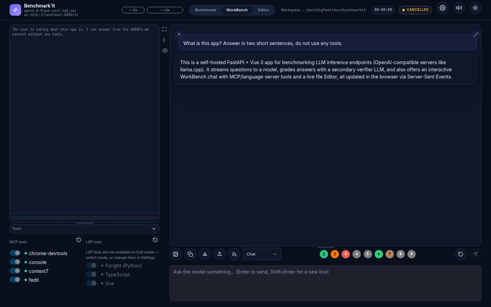
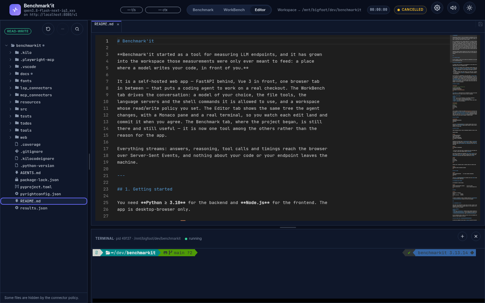

# Nojaé

**Nojaé is a workspace where a coding agent works in front of you: a place
where a model writes your code and you decide what to keep.**

It is a self-hosted web app — FastAPI behind, Vue 3 in front, one browser tab
in between — that puts that agent to work on a real checkout, in two pages. The
WorkBench tab drives the conversation: a model of your choice, the file tools,
the language servers and the shell commands it is allowed to use, and a
workspace whose read/write policy you set. The Editor tab shows the same tree
the agent changes, with a Monaco pane and a real terminal, so you watch each
edit land and commit it when you agree.

Everything streams: answers, reasoning, tool calls and timings reach the browser
over Server-Sent Events, and nothing about your code or your endpoint leaves the
machine.

---

## 1. Getting started

You need **Python ≥ 3.10** for the backend and **Node.js** for the frontend. The
app is desktop-browser only.

### Git Bash on Windows 🪟

On Windows, **Git for Windows is not optional**. It is what gives the two most
useful parts of the app a vocabulary there:

- The `console` MCP connector runs its whitelisted commands through Git's POSIX
  toolset (`ls.exe`, `grep.exe`, `find.exe`, `mv.exe` in `<Git>\usr\bin`) rather
  than a `cmd` vocabulary, so the same command list behaves the same on both
  systems.
- The Editor's terminal opens **Git Bash** as its shell, over a pseudo-console.
  It never falls back to `cmd.exe` or PowerShell: one terminal vocabulary,
  whatever the tab's folder.

The app looks for an installation in the usual places — `git` on `PATH` first,
then `C:\Program Files\Git`, `%LOCALAPPDATA%\Programs\Git`, Scoop and Chocolatey.
An installation is only accepted when its `usr\bin\ls.exe` is really there, so a
lone `git.exe` cannot be mistaken for one. If yours sits somewhere else, point
`NOJAE_GIT_BASH_DIR` at its install root. When nothing answers, the
terminal and the connector refuse **in words**, naming every folder they
searched — they never half-work.

### Setup on Windows

```powershell
# 1. Backend — from the project root
py -3.12 -m venv .venv
.venv\Scripts\Activate.ps1
pip install -e ".[mcp,lsp,windows]"
```

`pip install -e .` alone gives you the chat and the Editor; the extras are what
add the rest, and none of them is mandatory:

| Extra | What it adds |
|---|---|
| `mcp` | The MCP SDK and Playwright — the WorkBench connectors. |
| `lsp` | The LSP client — the language-server tools. |
| `windows` | The Editor terminal's pseudo-console driver. Never pulled in on Linux. |
| `test` | `pytest` and its plugins. |

```powershell
# 2. Frontend
cd web
npm install
npm run build
cd ..
```

Node is easiest to manage with [Volta](https://volta.sh), which pins the runtime
per project: `volta install node@22` in the project root, then `npm install -g
volta` once per machine. Volta keeps its shims in `%LOCALAPPDATA%\Volta\bin`, and
those shims shell out to `volta.exe` in `%ProgramFiles%\Volta` — remember both
folders, they come back when you declare a language server.

### Run on Windows

```powershell
.venv\Scripts\Activate.ps1
nojae
```

Then open <http://127.0.0.1:8001>. The Editor's terminal needs Git Bash to be
installed (and the `windows` extra); without either, it shows you what is missing
instead of an empty pane.

### Setup on Linux

Either environment works — pick one virtualenv manager, not both at once.

**Plain venv:**

```bash
cd /path/to/nojae
python -m venv .venv
source .venv/bin/activate
pip install -e ".[mcp,lsp]"
```

**pyenv:** this repo does **not** ship a `.python-version` — that file only
exists if you use pyenv, and you create it yourself. Name it after a `nojae`
virtualenv so it activates when you `cd` into the project; create that
environment first (`pyenv virtualenv 3.12 nojae`, or let `pyenv install` do
it), then:

```bash
pip install -e ".[mcp,lsp]"
```

> If you use a venv while pyenv is installed, make sure only **one** environment
> is active — pyenv shims otherwise shadow `.venv/bin`.

Then build the frontend. With **Volta**, `volta install node@22` in the project
root is enough and no `PATH` editing is involved; Volta installs under
`~/.volta/bin`, which your shell profile already puts on `PATH`:

```bash
cd web
npm install
npm run build
cd ..
```

Finally, when a connector drives a browser, install its runtime once:

```bash
playwright install --with-deps chromium
```

### Run on Linux

```bash
source .venv/bin/activate     # or: pyenv activate nojae
nojae
```

Then open <http://127.0.0.1:8001>. The terminal pane runs `$SHELL` (falling back
to `/bin/sh`) over a kernel PTY.

### Development (hot reload)

Two processes, on either system:

```bash
uvicorn src.api.server:app --reload --port 8001   # the API on :8001
cd web && npm run dev                             # Vite on :5173, proxying /api to :8001
```

### Tests

```bash
pip install -e ".[test]"
pytest                # backend
cd web && npm test    # frontend
```

The suite is hermetic: it needs no reachable model, `NOJAE_DISABLE_MCP`
/ `NOJAE_DISABLE_LSP` switch the two hubs off entirely, and every test runs on a
temporary settings store of its own — the install's `nojae.db` is never opened.

### Setting up tests for nojae

The end-to-end suite (`cd web && npm run test:e2e`) has **its own** model
connection, so a spec can never talk to a server this install is configured with.
Two files, one switch:

| File | Holds |
|---|---|
| `.env.test` (from `.env.test.example`) | The **app-level** keys — `LLM_DEBUG` and `NOJAE_PYTHON_ROOT`: the same set `.env` holds. |
| `.nojae/nojae-test-settings.json` | The suite's **model connection** — one `server` object holding one `model` object, spelled with the settings store's own column names: `name`, `url`, `api_key`, then the model's `name`, `sys_prompt`, samplers and `supports_vision`. |

`web/playwright.config.js` parses `.env.test` into the environment of the server
under test and exports `NOJAE_TEST_SETTINGS=1`, which is the one switch that puts
that server in **test mode**: it never opens the install's `nojae.db`, and works
instead on a temporary database it creates in a throw-away folder. The test
settings file's job is to **seed that database** — one server row, one model row,
and every agent pointed at that model — so the suite resolves a turn's connection
exactly the way a real turn does, against a configuration nobody else owns.
Nothing else turns it on — the backend suite pins it off.

**The test settings file is created by hand and never by the app.** It has no
committed template and the app never seeds, saves or rewrites it, so a
Settings-dialog save cannot change what the suite talks to, and it is invisible
to the built-in Editor (`.nojae` is reserved) — edit it outside the app. It is
gitignored with the rest of `.nojae`, so it may hold a real key; no document
about it may.

```json
{
  "server": {
    "name": "test-local",
    "url": "http://<test-host>:8080/v1",
    "api_key": "",
    "model": {
      "name": "<the test model id, exactly as the server names it>",
      "sys_prompt": "You are a helpful assistant.",
      "temperature": 1,
      "top_p": 0.95,
      "top_k": 20,
      "min_p": 0,
      "repeat_penalty": 1.0,
      "presence_penalty": 0,
      "reasoning": "off",
      "supports_vision": false
    }
  }
}
```

The member names are the store's **column** names, and every one of them is
required: the reader validates the file with the tables' own strictness, so an
unknown key, a missing one or a wrong type is a named failure rather than a
silently-defaulted sampler — a green suite that measured a default is worse than
a red one. Neither id appears, because the harness assigns both. Two things that
used to be members are **absent on purpose**: LSP activation is the workspace
declaration's `enable` flag alone, and the tool-loop cap is a per-agent number a
spec that needs one sets on its own agent row.

Write it at the installation folder's `.nojae/nojae-test-settings.json` — the
app's own checkout, which is the folder a new tab lands on. The suite resolves the
fixture there, never from a developer's configured folder and never from
`NOJAE_PATH_LOCATION`. The pinned samplers and `"reasoning": "off"` are what keep
the streaming specs reproducible.

**A missing file stops the whole suite before a spec runs**, with a message
naming the path — there is no fallback to this install's store, because a suite
that quietly reached your own servers and key would be green while proving
nothing. Fix it by writing the file above; then make sure the server it names is
reachable, since the endpoint stays a real one.

Two checks confirm the fixture really is what the suite talks to (one machine,
by hand):

1. Put a deliberately wrong `server.model.name` in the file and run the suite —
   the failure names `nojae-test-settings.json`.
2. Move the file away and run it again — the suite refuses to start, before any
   spec runs.

Both are cheap, and together they rule out the one failure mode this file
exists to prevent: a green run measured against someone else's server.

---

## 2. Configuring the app

Two kinds of thing configure the app. The **model connection, the agents and the
prompt-helper bullets** are rows of one SQLite database — `nojae.db`, at the
install root, created by the app on first boot and edited from the dialogs. The
**declarations** stay files, in a workspace's reserved `.nojae/`, and they are the
only settings a folder carries.

| | Holds | Written by |
|---|---|---|
| `nojae.db` (install root) | The servers and the models under them, each server with its key; the agents; the prompt helpers. | the Settings and Agent-modes dialogs — and nothing else |
| `.env` (from `.env.example`) | The install-scoped technical keys: `LLM_DEBUG` (log every request payload), `NOJAE_PYTHON_ROOT` (the python the stdio connectors run on), and the two numbers of the model-endpoint wait. | by hand; nothing in the dialog edits them |
| `.nojae/mcp-settings.json` (seeded from `mcp_connectors/mcp-settings.default.json`) | The MCP connectors the agent may call. | by hand; the dialog's toggles write each entry's `enable` flag |
| `.nojae/lsp-settings.json` (written from the seeded `.nojae/lsp-settings.template.json`) | The language servers. | by hand; same |

The database is **binary and single-writer**: never hand-edited, and with no
committed template, because it has no member you would type into it. It holds the
model keys, so it is gitignored like the other secret-bearing files, and it is
hidden from the Editor's tree, from file reads and search, and from both
connectors — the protection `.env` already has. A store the app cannot open is a
**named state**, never a silent empty one: the app bar says so in the one sentence
that names the path, and a chat turn refuses with that same sentence.

The two declaration files may carry API keys too, so they are gitignored and their
secrets are never returned by the API. Both belong to a workspace: when a folder is
first admitted, the app seeds the MCP declaration from its committed
template — with the `console` and `fedit` connectors pre-declared — and leaves the
LSP *template* beside it, a copy of `lsp_connectors/lsp_servers.example.json`. No
seed ever overwrites an existing file. The LSP declaration is never seeded as a
working file — its entries name machine-local paths — you write it yourself from
the template.

Nothing about the connection, the agents or the bullets travels with the folder:
point a tab at another project and the same servers, the same agents and the same
bullets answer there. The store is read afresh at the start of every turn, so a
dialog save needs no restart at all. `.env` follows the other rule: a hand-edit
waits for one.

### The model connection — Settings → **Servers**

A connection is two things, and the dialog edits them one after the other:

1. **Add a server** — a name you will recognise, its OpenAI-compatible base URL
   (`http://127.0.0.1:8080/v1` for a local llama.cpp), and its API key, which
   stays on the server and is never sent to a connector, a log or a tool listing.
   **Fetch models** asks that server what it offers: the names it answers with are
   listed in a table under the button, each with a **+** that adds that model
   under the server. The server must be saved first; the fetch dials its saved URL
   and key.
2. **Add a model under it** — the id *exactly as the server names it*, the system
   prompt that model is given, its samplers, and whether it accepts images. A
   sampler left empty is left out of the request rather than defaulted, so `0` and
   "not set" stay different values.

A server with no model under it dials nothing, and an agent with no model cannot
run — there is no default model to fall back on, so the composer says which agent
is unrunnable before the Send button lets you find out. Which agent runs on which
model is the agent's own field, set in the Agent-modes dialog.

### The agents — the pencil beside the composer's dropdown

The **Agent-modes** dialog holds the personas the composer offers. It is titled
**Agents**, and its left column is the agent list under a toolbar of three verbs —
add, save, delete — each acting on **the selected agent**: a row click shows that
agent's form, which holds a label, the two hub switches (whether the MCP tools and
the language servers reach it at all), the persona, the cap on that agent's tool
loop, and the model it runs on.

Add opens an empty form — a new agent joins the list only when a save succeeds —
and a save writes just the agent in view, leaving the dialog open. Delete asks
first, in the toolbar; `Close` is the only way out and asks the same way before
discarding typed edits. The agents nojae ships with are seeded into the store on
every boot, so no hand-edit and no damaged file can lose them; the one the lot
contract pins is **read-only** — it is listed like the others and its model is
yours to set, but everything else about it is re-asserted from code at each start.

Deleting a server, a model or an agent first copies the whole database into the
app's dated backup folder (`logs/editor_backups/`, kept as long as every other
backup the app makes), so the mistake is recoverable. And since the store has no
hand-edited member, that is the whole reset story: stop the app, remove `nojae.db`
and its `-wal`/`-shm` sidecars beside it, start it — the app rebuilds it with the
built-in agents and no servers.

### The MCP setup file — `.nojae/mcp-settings.json`

One entry per connector id, each with an `enable` flag that is the only switch
that counts. Two kinds:

- **`remote`** — a Streamable HTTP endpoint (`url` plus optional `headers`);
- **`local`** — a stdio child the hub starts and owns (`command` as an argv list,
  e.g. launched through `npx`).

Any `url`, `command`, `headers` or `env` value may reference an environment
variable as `${NAME}`, or `${NAME:-fallback}` when the variable is optional. The
reference is expanded when the file is read, using the environment the connector
runs with — the app's own, `.env` included — so one declaration works on every
machine and a secret can stay out of the file. Two names answer from the app
itself rather than from the environment: `${PROJECT_ROOT}` is this install's
own folder, always right by construction. Only the braced `${…}` form is
special, an
expanded value is never re-split into arguments, and an unset name is left
written as-is and reported as a validation note in **Settings → MCP** rather
than blanked.

**On Linux:**

```json
{
  "context7": {
    "type": "remote",
    "enable": true,
    "url": "${MCP_BASE_URL:-https://mcp.context7.com/mcp}",
    "headers": { "CONTEXT7_API_KEY": "${CONTEXT7_API_KEY}" }
  },
  "chrome-devtools": {
    "type": "local",
    "enable": true,
    "command": ["npx", "-y", "chrome-devtools-mcp@latest",
                "--executablePath=/usr/bin/chromium", "--headless"]
  },
  "console": {
    "type": "local",
    "enable": true,
    "description": "Console command",
    "command": ["/home/me/.pyenv/versions/nojae/bin/python",
                "${NOJAE_PATH_LOCATION}/mcp_connectors/console_mcp.py",
                "--root-dir", "${NOJAE_PATH_LOCATION}", "--transport", "stdio"]
  },
  "fedit": {
    "type": "local",
    "enable": true,
    "description": "File editor",
    "command": ["/home/me/.pyenv/versions/nojae/bin/python",
                "${NOJAE_PATH_LOCATION}/mcp_connectors/fedit_mcp.py",
                "--root-dir", "${NOJAE_PATH_LOCATION}", "--transport", "stdio"]
  }
}
```

**On Windows**, the same entries with the interpreter written the way a Windows
venv lays out — and nothing else about the file changes:

```json
{
  "console": {
    "type": "local",
    "enable": true,
    "description": "Console command",
    "command": ["${NOJAE_PATH_LOCATION}\\.venv\\Scripts\\python.exe",
                "${NOJAE_PATH_LOCATION}\\mcp_connectors\\console_mcp.py",
                "--root-dir", "${NOJAE_PATH_LOCATION}", "--transport", "stdio"]
  },
  "fedit": {
    "type": "local",
    "enable": true,
    "description": "File editor",
    "command": ["${NOJAE_PATH_LOCATION}\\.venv\\Scripts\\python.exe",
                "${NOJAE_PATH_LOCATION}\\mcp_connectors\\fedit_mcp.py",
                "--root-dir", "${NOJAE_PATH_LOCATION}", "--transport", "stdio"]
  }
}
```

The `npx` lines work as they do on Linux — the connector process inherits your
`PATH`, where npm put `npx` — so the only real difference is which Python you
name. Two rules of thumb anyway: the brace closes right after the variable name
(`${NOJAE_PATH_LOCATION}/web`, never `${NOJAE_PATH_LOCATION/web}`),
and a backslash inside a JSON string is written twice.

`console` and `fedit` are the two connectors shipped with the app — the shell
command surface and the file-edit surface (read, preview, apply, revert). Batch
mode needs both. They take `--root-dir`, so their reach is bounded by their own
deny-list, and `console` execs one command with no shell: no pipes, no
redirections, no command chains. `chrome-devtools` and `context7` are third-party
and entirely optional.

### The LSP setup file — `.nojae/lsp-settings.json`

When a folder is first admitted, the app leaves
`.nojae/lsp-settings.template.json` in its reserved folder — a copy of the
committed `lsp_connectors/lsp_servers.example.json`, never overwritten. Copy
it to `.nojae/lsp-settings.json` and adapt it; the app reads only
`lsp-settings.json`, and a workspace without one simply has no language
servers. One entry per server id: a stdio `command`, the `workspaceRoot` it
indexes, the file `extensions` it owns and the `tools` to expose. An enabled
server adds `lsp_<id>_<action>` tools — diagnostics, hover, definition,
references, symbols, completion, formatting — to the WorkBench tab.
`${NAME}` expansion works here exactly as it does for MCP.

One gate decides whether a server runs in this workspace: its `enable` flag in
`lsp-settings.json`. That file is the single source of truth, exactly as
`mcp-settings.json` is for the connectors — so a declaration you copy in with
`enable: true` starts those servers on first open, and a workspace cloned from
another machine runs what its own file says with nothing else to tick. The
Settings dialog's LSP section is an editor over that flag: a ticked row means
"this server runs here", the save writes the flag back to the file, and a
hand-edit of the file takes effect on the next hub restart (the section's
restart button, or an app restart).

There used to be a second switch agreeing with that flag, so a prepared
declaration could stay entirely dormant until servers were ticked. It is gone,
and with it the state where a declaration full of `enable: true` started nothing
— which is the honest reading of a file that says "enabled", and what MCP has
always meant by its own flag. The name `lspEnabled` survives in one place, for a
different question: the **conversation**-scoped `lspEnabled` the WorkBench Tools
panel holds and the Editor's code pane sends, which narrows the running servers
to the ones this conversation may use and can never add one that the declaration
has switched off.

Install the servers themselves with npm, the same line on either system (the
`lsp` extra only brings the Python client side):

```bash
npm install -g pyright typescript typescript-language-server @vue/language-server
```

**On Linux** — the form of the committed example, where `${VOLTA_BIN:-/usr/local/bin}`
covers both a Volta-managed install and a plain global one:

```json
{
  "pyright": {
    "enable": true,
    "label": "Pyright (Python)",
    "extensions": [".py", ".pyi"],
    "command": ["${VOLTA_BIN:-/usr/local/bin}/pyright-langserver", "--stdio"],
    "workspaceRoot": "${NOJAE_PATH_LOCATION}",
    "env": { "PATH": "${VOLTA_BIN:-/usr/local/bin}:/usr/local/bin:/usr/bin:/bin" },
    "initializationOptions": { "typeCheckingMode": "standard" },
    "tools": ["diagnostics", "hover", "definition", "references", "document_symbols"],
    "idleShutdownSeconds": 300
  },
  "typescript": {
    "enable": true,
    "label": "TypeScript",
    "extensions": [".ts", ".tsx", ".js", ".mjs", ".cjs", ".json"],
    "command": ["typescript-language-server", "--stdio"],
    "workspaceRoot": "${NOJAE_PATH_LOCATION}/web",
    "lazy": true,
    "initializationOptions": { "tsserver": { "path": "/usr/local/lib/node_modules/typescript" } },
    "tools": ["diagnostics", "hover", "definition", "references", "document_symbols",
              "completion", "signature_help", "formatting"],
    "idleShutdownSeconds": 300
  },
  "vue": {
    "enable": true,
    "label": "Vue",
    "extensions": [".vue"],
    "command": ["vue-language-server", "--stdio",
                "--tsdk=${NOJAE_PATH_LOCATION}/web/node_modules/typescript/lib"],
    "workspaceRoot": "${NOJAE_PATH_LOCATION}/web",
    "lazy": true,
    "tools": ["diagnostics", "hover", "definition", "references", "document_symbols",
              "completion", "formatting"],
    "idleShutdownSeconds": 300
  }
}
```

**On Windows** the same three entries take a different shape, and the two
differences are exactly why a Linux declaration copied verbatim fails there:

```json
{
  "pyright": {
    "enable": true,
    "extensions": [".py", ".pyi"],
    "command": ["pyright-langserver", "--stdio"],
    "workspaceRoot": "${NOJAE_PATH_LOCATION}",
    "env": { "PATH": "${LOCALAPPDATA}\\Volta\\bin;${ProgramFiles}\\Volta" },
    "initializationOptions": { "typeCheckingMode": "standard" },
    "tools": ["diagnostics", "hover", "definition", "references", "document_symbols"],
    "idleShutdownSeconds": 300
  },
  "typescript": {
    "enable": true,
    "extensions": [".ts", ".tsx", ".js", ".mjs", ".cjs", ".json"],
    "command": ["typescript-language-server", "--stdio"],
    "workspaceRoot": "${NOJAE_PATH_LOCATION}/web",
    "lazy": true,
    "env": { "PATH": "${LOCALAPPDATA}\\Volta\\bin;${ProgramFiles}\\Volta" },
    "tools": ["diagnostics", "hover", "definition", "references", "document_symbols",
              "completion", "signature_help", "formatting"],
    "idleShutdownSeconds": 300
  },
  "vue": {
    "enable": true,
    "extensions": [".vue"],
    "command": ["vue-language-server", "--stdio",
                "--tsdk=${NOJAE_PATH_LOCATION}/web/node_modules/typescript/lib"],
    "workspaceRoot": "${NOJAE_PATH_LOCATION}/web",
    "lazy": true,
    "env": { "PATH": "${LOCALAPPDATA}\\Volta\\bin;${ProgramFiles}\\Volta" },
    "tools": ["diagnostics", "hover", "definition", "references", "document_symbols",
              "completion", "formatting"],
    "idleShutdownSeconds": 300
  }
}
```

- **The `PATH` separator is `;`, not `:`** — and an `env.PATH` *replaces* the
  child's `PATH` wholesale, so it must carry every folder the command resolves
  through: with Volta, both the shim folder and the one holding `volta.exe` and
  `node.exe`, otherwise the shim starts and immediately fails.
- **Write the command as the bare program name.** What npm and Volta install
  under `pyright-langserver` is a `#!/bin/bash` script Windows cannot exec; the
  hub resolves `argv[0]` with `shutil.which` over the child's own `PATH`, which
  honours `PATHEXT` and finds the `.cmd` beside it. When nothing answers the
  name, the server is left at `error` with a sentence naming the command and the
  folders searched.

`${VOLTA_BIN}` is a POSIX idea and there is no conditional in `${…}` — no
platform test, no OS-dependent default — which is why the example file states the
Windows form in a `_windows_note` instead of pretending one string fits both.

Two more knobs worth knowing:

- **`"lazy": true`** spawns a server on its first tool call instead of with the
  app (tsserver's cold start is multi-second and eats RAM). A settings panel
  listing a lazy server as *stopped* is not a failure.
- **`lsp_connectors/restricted-paths.txt`** lists, one prefix per line and in
  both platforms' path forms (`/etc`, `${SystemRoot}`, `${HOME}/.ssh`,
  `${USERPROFILE}/.aws`, …), the roots no `workspaceRoot` may sit inside. A
  language server indexing a secret tree would put that tree in the model's
  context window, so the declaration is refused instead.

### The working location

The working location belongs to **the tab**, not the app: each tab points at one
folder, holds it in its own `sessionStorage`, and sends it with every request that
needs it. A reload keeps the folder; a new tab starts on the installation
directory; the address bar never carries it, so two tabs on the same address can
work on two folders at once.

The **app bar** holds this tab's field: type another folder and press **Set** to
point that tab's MCP and LSP tools, the Editor's tree and new terminal sessions at
it in one step. Set is inert while a WorkBench reply or a batch is running **in
this tab** — a session must not have its root moved out from under it. The folder
must exist and must not sit under a restricted path. The server resolves the
folder for each request; no setting holds it. In a declaration, reference it as
`${NOJAE_PATH_LOCATION}` — the placeholder expands to the workspace being served,
so one declaration is correct in every tab. `${PROJECT_ROOT}` keeps meaning the
installation.

That folder gets its own read/write policy in `.nojae/read-write-policy.json`
inside it, which answers one question per file — `rw`, `ro` or `hidden` — for the
Editor *and* for the agent's file tools: a folder you mark `ro` is not editable by
an agent either. The file is seeded for you (dependency and build folders come
read-only) and edited outside the app — see
[`docs/POLICY-MANAGEMENT-DOC-EN.md`](docs/POLICY-MANAGEMENT-DOC-EN.md). The
settings store is deliberately **not** part of that switch: the servers, the
agents and the bullets are the install's, so moving a tab invalidates only that
workspace's hubs, policy and tree caches.

### The install's technical keys — `.env`

Copy `.env.example` to `.env` when you want to turn the request logging on, to
name the interpreter your connectors run on, or to change how long a refused
model round is waited on. This file holds only what is scoped to **this nojae
install** and edited by hand: the model connection — servers, their models,
keys, prompts, sampling and the vision flag — is in the settings store, edited
from the Settings dialog, and the tool-loop cap is a number on each agent (see
the table at the top of this section). What is left here are the technical keys
below, and nothing in the dialog edits them:

```bash
#LLM_DEBUG=1                # logs every request payload to the console
#NOJAE_PYTHON_ROOT=         # the python the stdio connectors run on
#NETWORK_FAIL_MAX_RETRY=3   # how many times a refused round is asked again
#NETWORK_FAIL_WAIT_FOR=10   # seconds between two attempts at that round
```

All four are **hand-edited managed keys**: a settings save keeps them, but
nothing in the dialog edits them. `LLM_DEBUG=1` makes the LLM client log the
payload of every request to the server console — very verbose, and switched back
off once the failure is read.

`NETWORK_FAIL_MAX_RETRY` and `NETWORK_FAIL_WAIT_FOR` are the two numbers of the
endpoint wait described under
[One configuration, one streaming layer](#one-configuration-one-streaming-layer):
how many times one refused round is asked again, and the seconds between two
attempts at it. Both defaults are non-zero, so the wait is **on with no
configuration at all**; `NETWORK_FAIL_MAX_RETRY=0` switches it off and a refused
round fails on its first attempt. One round can hold the turn for at most the
product of the two — `120 × 30s` is two hours — and that hold is not free: a
reply stays in flight through the wait, so **the Editor refuses every write to
its folder** until the round lands. A generous budget is therefore a long window
in which that workspace cannot save, and **Stop** closes it at once. A blank,
non-numeric or negative value is never silently coerced: the default answers for
that key alone, and `GET /api/config` answers the effective pair with a note
naming every key whose written value was unusable — so a typo there is visible
instead of being a stall with extra steps.

A `.env` save **regenerates the file from a fixed template**: fixed key set and
order, empty optional keys commented out, hand-written extras lost. Add or rename
a key and you change the template, the renderer and the committed example
together.

The e2e suite reads the same app-level keys from `.env.test`, and its model
connection from the test settings file — see
[Setting up tests for nojae](#setting-up-tests-for-nojae).

### Run

Both systems, once the two builds above are done:

```bash
nojae          # API + UI on http://127.0.0.1:8001
```

Nothing else is required for the Editor. A fresh checkout's WorkBench needs one
thing: the model connection, which **Settings → Servers** writes into the install's
settings store — a fresh one holds no server and says so in the app bar, and until
an agent is given a model no turn can run. The connectors and servers only decide
how far the agent may reach.

---

## 3. What the app does

### WorkBench — where the work happens 💬



A streaming chat with your configured model, in an **agent** you pick from the
composer: **Chat** (no tools at all), **Code** (file tools and language
servers — the agent that implements, and leaves the tree compiling and tested),
**Architect** (reads and asks, writes only a markdown spec), and **Todo builder**,
which turns a spec into a numbered lot of task files and is defined by the app.
An agent replaces the persona sent to the model, decides whether a whole tool hub
reaches it at all, and names the model the turn runs on; it can only ever narrow
what Settings already allows. The composer opens on the agent this browser used
last, like the theme and the other per-browser preferences.

The **pencil** beside that dropdown opens the **Agents** dialog: the store's agent
rows in a list under a toolbar of three verbs — add, save, delete — each acting on
**the selected agent**. A row's form holds a label, the two hub switches, the
persona, the cap on that agent's tool loop and its model, with the app's caps
enforced as you type; a save writes just the agent in view and leaves the dialog
open. The four agents nojae ships with are listed there too, and the app-owned
**Todo builder** is the read-only one: its tab renders, its model is yours to set,
and everything else about it is re-asserted from code at every boot, so no edit —
here or anywhere — can drift it. An agent with no model shows a warning beside the
pencil and cannot be sent to; the fix is either to give it a model in that dialog
or to pick an agent that has one.

**Batch mode** works through a folder of task files — `todos/` by default, files
named `01-slug.md`, `02-slug.md`, …, with `00-…` as the lot's big picture, which
rides on every request. One task is one chat turn; the app never reads a task
body, it only hands the model the path and lets its own connectors open it. A
task counts as finished when its **file has left the folder** — the agent moves
it into `todos/done`, which is its own acknowledgement — so a file still in place
is relaunched with a note saying why, up to three times, after which the lot
aborts. Each relaunch first waits a rising interval (5s, then 15s, then 30s), so
a slow trailing move is absorbed rather than costing a wasted turn; Stop cuts
that wait short. An endpoint that refuses mid-task is waited out by the round
wait described under
[One configuration, one streaming layer](#one-configuration-one-streaming-layer),
not by a relaunch: the turn is not lost, so the lot sees its usual outcome and
its own rules are untouched — a wait that runs out of budget still ends the lot.
The agent is pinned when the lot launches
— the one the composer's dropdown shows, the same agent a standard session of that
choice would run as — so moving the composer's choice mid-lot reaches no task, and
a lot whose selected agent is missing or has no model refuses at launch rather
than running under an agent nobody chose. The conversation is reset between tasks,
and continuity comes from disk: git and the files that moved.
Batch mode refuses to start unless the connectors it depends on are on, and unless
the selected agent can reach them.

Around the composer: the reasoning and tool panel (every tool call, its result
and the server that answered), image attach when the model in view accepts images,
the prompt-helper bullets (the install's, so the same bullets answer in every
workspace — as many as you have added, and no fixed count), and Save / Load of a
conversation as a plain JSON file. Markdown renders with KaTeX, highlighted code
and Mermaid diagrams, always through the sanitizer.

When the model endpoint refuses and could answer later, one quiet line appears in
that strip for as long as the wait lasts — **`Reconnecting 2/3`**, then the
endpoint's own sentence quoted exactly as it came, and the seconds until the
request goes out again. Nothing else changes on screen: the conversation gains no
message and no marker for a wait, the composer stays shut and the running
indicator stays lit, because the reply is still in flight — and **Stop** ends the
wait at once.

The app bar carries the session meters: the elapsed clock, the generation speed
and the context-window occupancy. They describe the **conversation**, not one
reply, so they keep their figures when an answer lands and the next question
continues the same totals. Only **Restart conversation** in the composer puts
them back to zero. The clock counts the time the conversation worked: it
**excludes** the seconds a turn spent waiting on the model endpoint — a wait is
neither inference nor thinking, so a 40-minute provider outage is not a
40-minute session — while the turn's own span **keeps** them and states the
waited part beside it. That pair is how "took 41 minutes" is told apart from
"took 1 minute and waited 40"; the speed figure holds either way, since a wait
contributes no token.

`Enter` sends and `Shift`+`Enter` writes a new line. The toggle left of the Stage
button swaps the two, so a long message can be finished — and reread — before it
is sent. It is a preference of this browser, remembered between sessions.

`Ctrl`+`Enter` — `Cmd`+`Enter` on a Mac — or the **Stage** button beside that
toggle stages the draft instead: the message, with its images, moves to a
numbered strip above the draft preview, and the composer empties for the next one,
so a brief spanning several messages is written before the model sees any of it.
Staging is not about newlines, so it means the same under either setting of the
toggle. A row of the strip can be removed, or pulled back into the composer to be
edited, and the sending key then sends the whole set as **one** turn — the strip
in its order, then the draft — on one connection, with one reply and one set of
meters answering for all of it. Images belong to the message they were attached
to, and a message may carry several; up to six images fit across what one turn
carries, and the seventh is refused as you attach it. Restarting the conversation
clears the strip with it.

Every reply carries its own copy button, on the top-right corner of its panel:
half-visible until the pointer enters the card, it puts that one answer on the
clipboard as the model wrote it. The composer's own button above the textarea is
the one that copies the whole conversation, as markdown.

### Editor — the same tree, in your hands 🗂



This tab's folder as a file tree and a Monaco pane: create, rename, move and
delete, save with a diff against the last commit, git status badges on the rows,
a search that answers for the same set of files the tree lists, and **one
terminal per connection**, on the platform's pseudo-terminal — `$SHELL` on
POSIX, Git Bash on Windows.

Nothing here is destroyed. Every save keeps the bytes it replaced in a backup
folder, and a delete moves the file into a dated batch under the reserved
`.nojae/trash/` of the current workspace (kept 30 days), so a restore is
one `mv` away. `Ctrl`+click a group of rows, right-click, `Move to…`: the set
moves whole in one request, and a file that is open keeps its tab and its
unsaved edits at the new path.

The code pane is served by the same language servers the WorkBench tools use:
`Ctrl`+click a name to land on its definition, hover a symbol for its type and
docstring, and find its references — answered about the buffer on screen, unsaved
edits included. They are the servers you declared and switched on for the
conversation, so a server switched off in the WorkBench **Tools** panel is a dead
`Ctrl`+click here too, and the pane's status line names the one serving the file
you are looking at. A file no server claims is quiet: the gesture simply does
nothing, and the status line says why. Setting the servers up is *The LSP setup
file* above.

The Editor's writes are the browser's own surface — never reachable from a
connector, a tool or a chat path — and they are refused while a reply streams.
That is asserted by a test rather than trusted.

### One configuration, one streaming layer

Both tabs call the model through the same client against an
OpenAI-compatible endpoint — llama.cpp, vLLM, or a hosted one — so adding a model
is configuration, never code. Every reply is one stream that closes with exactly
one terminal event, so a paused answer still ends as a kept partial turn.
Configuration changes are live the moment the Settings dialog saves them; a
hand-edit of a hub declaration file is picked up by its **Refresh**, and only a
hand-edit of `.env` waits for a server restart.

When that endpoint answers a request with a failure that says *ask again later* —
a provider-side `5xx`, a rate limit, a refusal to connect, a stalled read — the
turn does not end there: nojae waits out the pause and sends the **identical**
request again, until the endpoint answers usefully or the budget of
`NETWORK_FAIL_MAX_RETRY` is spent. That is where the whole guard sits and why it
is invisible to the browser: the link that broke is between **this server and the
endpoint**, never the one between the page and the server — the page's own
connectivity is innocent and is never watched. The resume is exact rather than
approximate, because the failure lands before a single byte of the reply exists:
the replay carries what the failed attempt was about to send, the earlier rounds'
tool results still in the message list, and the turn closes on its normal
terminal frame — so a batch lot reads its usual outcome and moves on, which is
how an unattended lot finishes by itself instead of waiting for someone to press
Start again.

Two things are deliberately **not** waited on: a hard refusal — a revoked key, an
unknown model, a malformed request, anything the endpoint is certain about — and
any stream that broke *after* text had arrived. Both stay final because waiting
on a diagnosis turns a one-second error line into a silent stall, and replaying a
cut stream would duplicate the text on screen or discard it without saying so.
