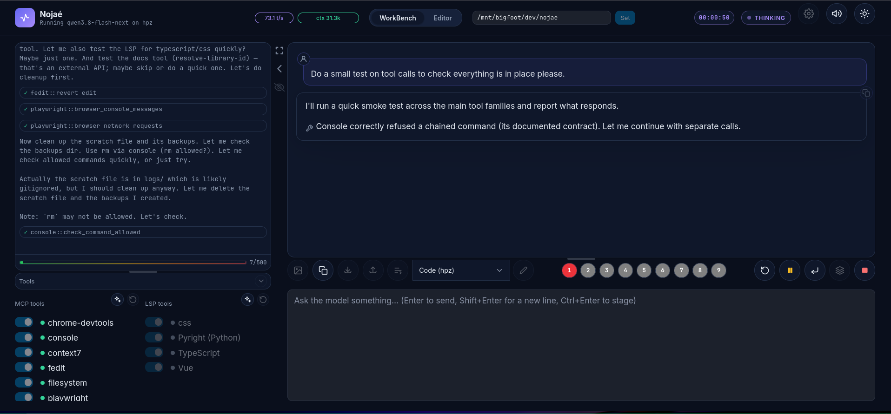
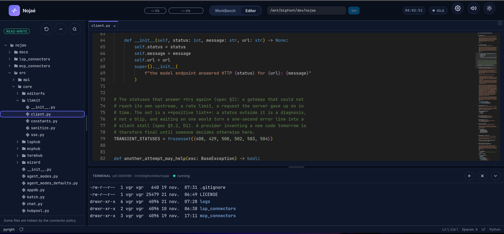

<!-- Moved out of README.md so the front page stays short. The prose is
     verbatim -- edit it here, the README links here. -->

# What the app does

The two tabs in detail, the skills folder, and how one configuration and
one streaming layer serve both.

### WorkBench — where the work happens 💬



A streaming chat with your configured model, in an **agent** you pick from the
composer: **Chat** (no tools at all), **Code** (file tools and language
servers — the agent that implements, and leaves the tree compiling and tested),
**Architect** (reads and asks, writes only a markdown spec), and **Todo builder**,
which turns a spec into a numbered lot of task files and is defined by the app.
An agent replaces the persona sent to the model, decides whether a whole tool hub
reaches it at all, and names the model the turn runs on; it can only ever narrow
what Settings already allows. The composer opens on the agent this browser used
last, like the theme and the other per-browser preferences.

The **pencil** beside that dropdown opens the **Agents** dialog: the store's agent
rows in a list under a toolbar of three verbs — add, save, delete — each acting on
**the selected agent**. A row's form holds a label, the two hub switches, the
persona, the cap on that agent's tool loop and its model, with the app's caps
enforced as you type; a save writes just the agent in view and leaves the dialog
open. The four agents nojae ships with are listed there too, and the app-owned
**Todo builder** is the read-only one: its tab renders, its model is yours to set,
and everything else about it is re-asserted from code at every boot, so no edit —
here or anywhere — can drift it. An agent with no model shows a warning beside the
pencil and cannot be sent to; the fix is either to give it a model in that dialog
or to pick an agent that has one.

**Batch mode** works through a folder of task files — `todos/` by default, files
named `01-slug.md`, `02-slug.md`, …, with `00-…` as the lot's big picture, which
rides on every request. One task is one chat turn; the app never reads a task
body, it only hands the model the path and lets its own connectors open it. A
task counts as finished when its **file has left the folder** — the agent moves
it into `todos/done`, which is its own acknowledgement — so a file still in place
is relaunched with a note saying why, up to three times, after which the lot
aborts. Each relaunch first waits a rising interval (5s, then 15s, then 30s), so
a slow trailing move is absorbed rather than costing a wasted turn; Stop cuts
that wait short. An endpoint that refuses mid-task is waited out by the round
wait described under
[One configuration, one streaming layer](#one-configuration-one-streaming-layer),
not by a relaunch: the turn is not lost, so the lot sees its usual outcome and
its own rules are untouched — a wait that runs out of budget still ends the lot.
The agent is pinned when the lot launches
— the one the composer's dropdown shows, the same agent a standard session of that
choice would run as — so moving the composer's choice mid-lot reaches no task, and
a lot whose selected agent is missing or has no model refuses at launch rather
than running under an agent nobody chose. The conversation is reset between tasks,
and continuity comes from disk: git and the files that moved.
Batch mode refuses to start unless the connectors it depends on are on, and unless
the selected agent can reach them.

Around the composer: the reasoning and tool panel (every tool call, its result
and the server that answered), image attach when the model in view accepts images,
the prompt-helper bullets (the install's, so the same bullets answer in every
workspace — as many as you have added, and no fixed count), and Save / Load of a
conversation as a plain JSON file. Markdown renders with KaTeX, highlighted code
and Mermaid diagrams, always through the sanitizer.

When the model endpoint refuses and could answer later, one quiet line appears in
that strip for as long as the wait lasts — **`Reconnecting 2/3`**, then the
endpoint's own sentence quoted exactly as it came, and the seconds until the
request goes out again. Nothing else changes on screen: the conversation gains no
message and no marker for a wait, the composer stays shut and the running
indicator stays lit, because the reply is still in flight — and **Stop** ends the
wait at once.

The app bar carries the session meters: the elapsed clock, the generation speed
and the context-window occupancy. They describe the **conversation**, not one
reply, so they keep their figures when an answer lands and the next question
continues the same totals. Only **Restart conversation** in the composer puts
them back to zero — and the connector wizard's reasoning belongs to **no
conversation**, so its model calls add to none of these figures and none of
their numbers is shown. The clock counts the time the conversation worked: it
**excludes** the seconds a turn spent waiting on the model endpoint — a wait is
neither inference nor thinking, so a 40-minute provider outage is not a
40-minute session — while the turn's own span **keeps** them. The speed figure
holds either way, since a wait contributes no token.

`Enter` sends and `Shift`+`Enter` writes a new line. The toggle left of the Stage
button swaps the two, so a long message can be finished — and reread — before it
is sent. It is a preference of this browser, remembered between sessions.

`Ctrl`+`Enter` — `Cmd`+`Enter` on a Mac — or the **Stage** button beside that
toggle stages the draft instead: the message, with its images, moves to a
numbered strip above the draft preview, and the composer empties for the next one,
so a brief spanning several messages is written before the model sees any of it.
Staging is not about newlines, so it means the same under either setting of the
toggle. A row of the strip can be removed, or pulled back into the composer to be
edited, and the sending key then sends the whole set as **one** turn — the strip
in its order, then the draft — on one connection, with one reply and one set of
meters answering for all of it. Images belong to the message they were attached
to, and a message may carry several; up to six images fit across what one turn
carries, and the seventh is refused as you attach it. Restarting the conversation
clears the strip with it.

Every reply carries its own copy button, on the top-right corner of its panel:
half-visible until the pointer enters the card, it puts that one answer on the
clipboard as the model wrote it. The composer's own button above the textarea is
the one that copies the whole conversation, as markdown.

### Editor — the same tree, in your hands 🗂



This tab's folder as a file tree and a Monaco pane: create, rename, move and
delete, save with a diff against the last commit, git status badges on the rows,
a search that answers for the same set of files the tree lists, and **one
terminal per connection**, on the platform's pseudo-terminal — `$SHELL` on
POSIX, Git Bash on Windows. The terminal's header carries the session's pid,
path and state beside two buttons that renew and kill the shell, and a chevron
that folds the pane away so the code pane takes the room — click it again and
the terminal comes back at the height you left it.

Nothing here is destroyed. Every save keeps the bytes it replaced in a backup
folder, and a delete moves the file into a dated batch under the reserved
`.nojae/trash/` of the current workspace (kept 30 days), so a restore is
one `mv` away. `Ctrl`+click a group of rows, right-click, `Move to…`: the set
moves whole in one request, and a file that is open keeps its tab and its
unsaved edits at the new path.

The code pane is served by the same language servers the WorkBench tools use:
`Ctrl`+click a name to land on its definition, hover a symbol for its type and
docstring, and find its references — answered about the buffer on screen, unsaved
edits included. They are the servers you declared and switched on for the
conversation, so a server switched off in the WorkBench **Tools** panel is a dead
`Ctrl`+click here too. Setting the servers up is *The LSP setup file* above.

The status bar along the bottom of the screen names the server serving the file
on screen and answers the question an editor without it would answer with a lie
— *is this file OK?* A real defect is underlined in red, marked on the overview
ruler so an off-screen one still shows at the right edge, and named by hovering
it; fixing it takes the underline away, hints and information are counted
without a mark, and the underlines stay put while a reply streams over a
read-only pane. A file no server claims gets none and the bar says why, reading
**analysing…** until an analysis exists and **no problems** only once a server
has actually judged the file. One control in the strip re-checks by hand.

Its right edge answers a different question — *what is this buffer?* — the way a
code editor does: the caret's line and column, the indentation the buffer
actually uses (`Spaces: 2`, `Tab: 4`), its line ending (`LF` / `CRLF`) and the
file's kind by its grammar's own name (`JSON`, `Python`). The indentation is the
one Monaco guessed from the text rather than a default, and these fields are
absent — not stale — while a diff tab, a preview or an empty pane is on screen.

Each tab remembers **where you were reading it**: switch away and come back and
the pane is scrolled to the same line, with the caret where you left it.

The Editor's writes are the browser's own surface — never reachable from a
connector, a tool or a chat path — and they are refused while a reply streams.
That is asserted by a test rather than trusted.

### Skills — packaged know-how the agent reads on demand 📚

A **skill** is a folder holding a `SKILL.md` file: one procedure, one file
format, one house style, written down once. You put such a folder inside a
`.agents/skills` folder — either in the **workspace**, so it travels with the
checkout, or in your **home folder**, so it is available in every workspace —
and the agent starts every conversation already knowing it exists.

What the agent is given is the **catalogue**: every skill's name, its
description, and the path of its `SKILL.md`. That is all it sees until it needs
one — the body of the file reaches the conversation only when the model opens
it, and only when the subject of the conversation actually matches the
description. So the description is the part doing the work: write it as an
answer to "when should this be used?".

The header needs two fields: `name`, matching the folder that holds it, and a
one-line `description` saying what the skill is for and when to use it.

```markdown
---
name: commit-message
description: How this project writes git commit messages. Use when committing, or when describing a change in words.
---

Subject line: imperative, under 50 characters, no trailing period.

Body: what changed and why, wrapped at 72 columns. Never list files the diff
already shows.
```

That is a whole skill — copy it to `.agents/skills/commit-message/SKILL.md` and
it works. **Nothing needs enabling**: there is no setting, no dialog and no key
for this. Put the folder there and the next message sees it; edit the file and
the next message sees that; delete the folder and the next message has no such
entry.

One condition: a skill is offered only to a turn that has a connector able to
open a file, so an agent with no tools is never told about a list it could not
read.

A skill stays **your file**: the catalogue tells the model never to create,
rename, edit or delete one, so a skill is written by you — in the Editor, or by
copying a folder in. It is an ordinary project folder, not a reserved one.

**Skills are a convention, not one product's property**, so a collection
installed for another agent product is usually a folder of valid skills
already. nojae scans `.agents/skills` and nothing else, so the bridge is a link
you make:

```bash
# reuse a machine-wide collection installed for another product
ln -s ~/.other-product/skills ~/.agents/skills

# reuse a project's collection
ln -s ../.other-product/skills .agents/skills
```

Two things a link costs, both better read here than discovered by being
confused:

- **A link is followed, and it is judged where it lands.** Inside the workspace,
  the connector resolves the link and applies the workspace policy to the
  target, so a link out of the workspace is not a way to read a file the policy
  refuses. Outside it, the connector's own deny-lists apply to the target — a
  collection under a folder that holds credentials is refused there too.
- **A link whose target is outside the workspace is catalogued with its real
  path**, and that is the path the agent is told to open. Correct, but
  surprising the first time: the entry does not sit under your project.

### One configuration, one streaming layer

Both tabs call the model through the same client against an
OpenAI-compatible endpoint — llama.cpp, vLLM, or a hosted one — so adding a model
is configuration, never code. Every reply is one stream that closes with exactly
one terminal event, so a paused answer still ends as a kept partial turn.
Configuration changes are live the moment the Settings dialog saves them; a
hand-edit of a hub declaration file is picked up by its **Refresh**, and only a
hand-edit of `.env` waits for a server restart.

When that endpoint answers a request with a failure that says *ask again later* —
a provider-side `5xx`, a rate limit, a refusal to connect, a stalled read — the
turn does not end there: nojae waits out the pause and sends the **identical**
request again, until the endpoint answers usefully or the budget of
`NETWORK_FAIL_MAX_RETRY` is spent. That is where the whole guard sits and why it
is invisible to the browser: the link that broke is between **this server and the
endpoint**, never the one between the page and the server — the page's own
connectivity is innocent and is never watched. The resume is exact rather than
approximate, because the failure lands before a single byte of the reply exists:
the replay carries what the failed attempt was about to send, the earlier rounds'
tool results still in the message list, and the turn closes on its normal
terminal frame — so a batch lot reads its usual outcome and moves on, which is
how an unattended lot finishes by itself instead of waiting for someone to press
Start again.

Two things are deliberately **not** waited on: a hard refusal — a revoked key, an
unknown model, a malformed request, anything the endpoint is certain about — and
any stream that broke *after* text had arrived. Both stay final because waiting
on a diagnosis turns a one-second error line into a silent stall, and replaying a
cut stream would duplicate the text on screen or discard it without saying so.
